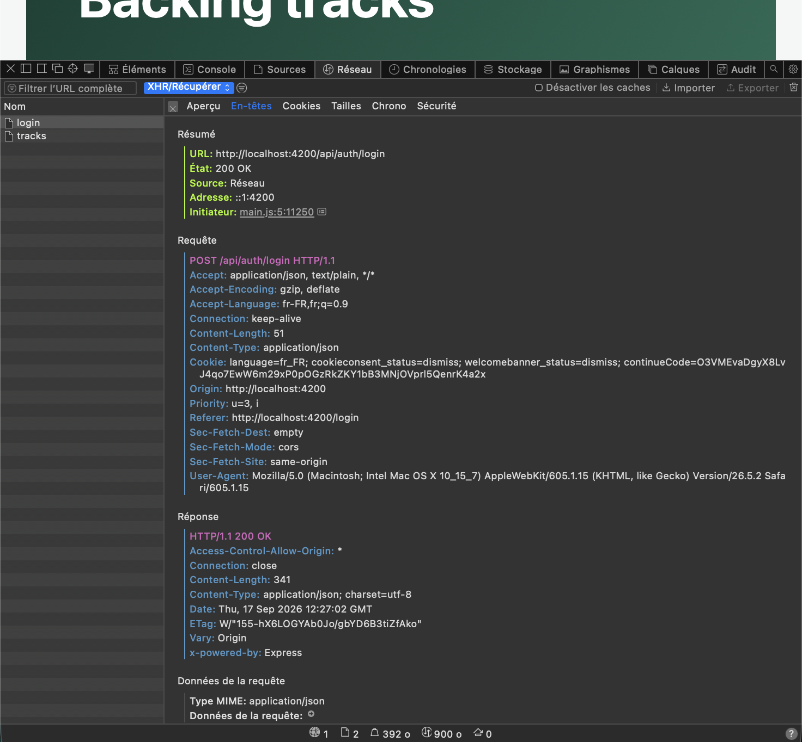
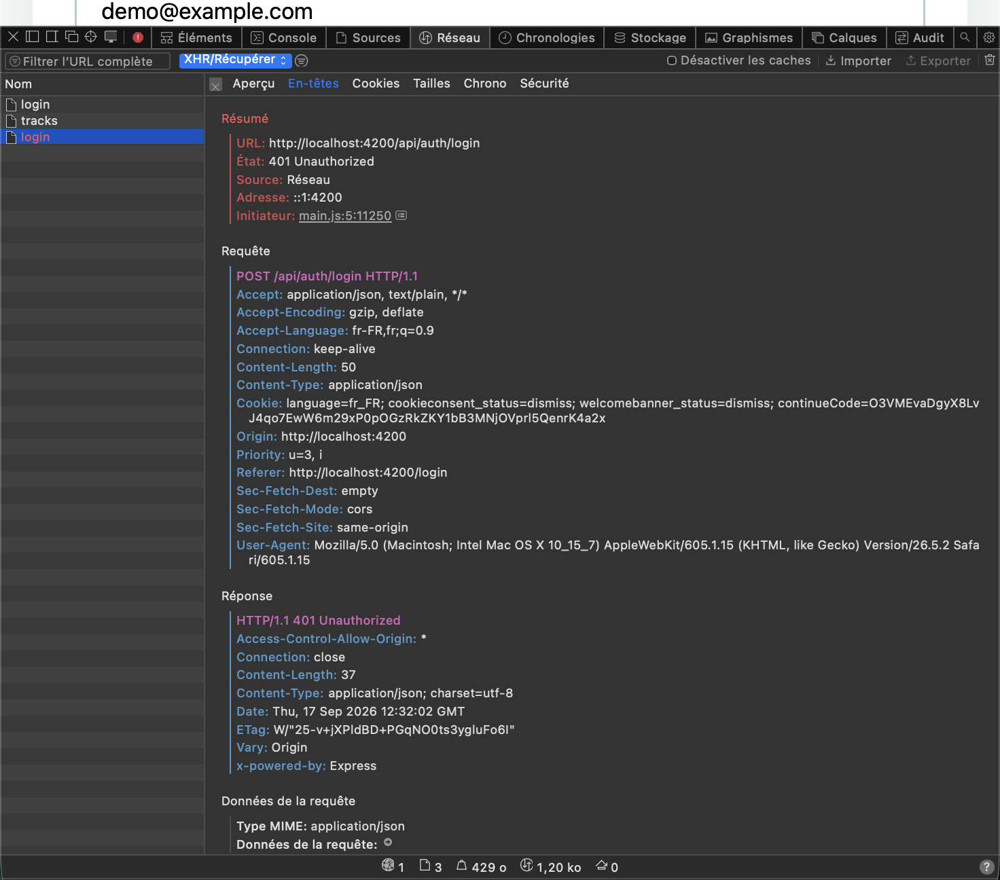
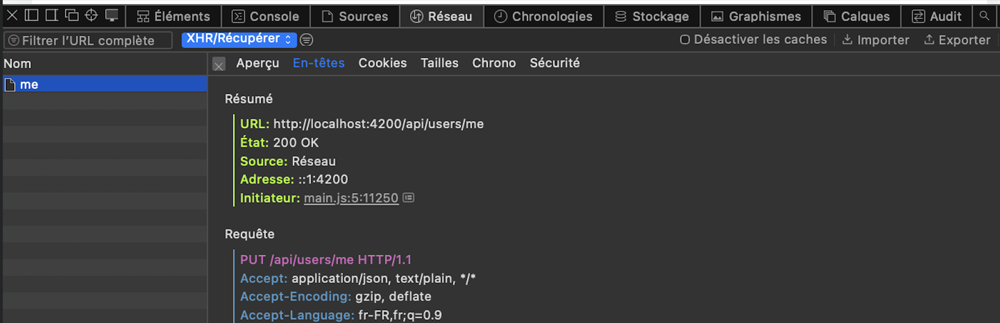
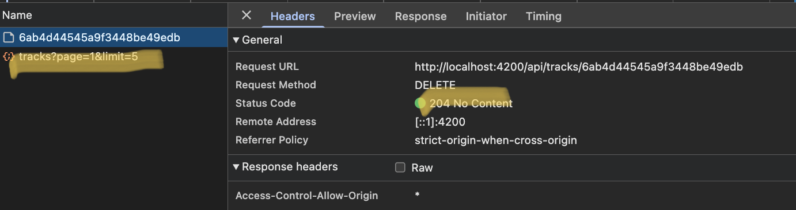
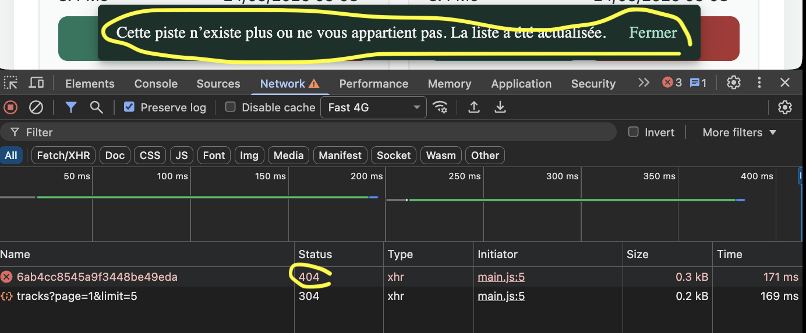

# Rapport d'usage de l'IA - TP1 à TP3

**Binôme :** Meric VAILLANT et Noa PISTONE.
Chaque TP est partagé en deux parties à peu près égales, une par membre du binôme.
Chacun a relu la partie de l'autre et sait l'expliquer.

## Cadre commun

- **Assistants :** GitHub Copilot (VS Code, mode chat) pour le TP1 et le début du TP2 ; Claude Code (extension VS Code), modèle Claude Opus 5.5, pour la fin du TP2 et le TP3.
- **Consommation de tokens :** `/cost` ou `/usage` dans Claude Code ; tableau de bord d'utilisation du compte GitHub pour Copilot.
- **Choix du modèle :** documentation de l'éditeur et consignes de l'enseignant. On prend un modèle rapide pour les tâches simples et un modèle de raisonnement pour l'architecture ou le débogage.
- **Cadre donné à l'IA :** [`DOCTRINE.md`](DOCTRINE.md), référencée depuis `CLAUDE.md`, `AGENTS.md` et `GEMINI.md`. Skill officiel Angular installé après lecture de son contenu (`npx skills add https://github.com/angular/skills`).
- **Sécurité :** aucune URI MongoDB, aucun secret JWT ni mot de passe dans les prompts, le dépôt ou ce rapport. `backend/.env` est ignoré par Git.

## Grille de vérification des missions

Chaque partie ci-dessous détaille, dans cet ordre :

1. l'**objectif** ;
2. le **prompt principal** ;
3. le **plan proposé par l'agent** ;
4. les **vérifications réalisées par le binôme** ;
5. les **erreurs ou propositions rejetées** ;
6. les **fichiers effectivement modifiés** ;
7. la **preuve de fonctionnement** ;
8. **ce que le membre sait maintenant expliquer sans l'agent**.

Les prompts sont reformulés à partir de nos demandes. Les chemins de fichiers partent de `frontend-starter/src/app/`, sauf indication contraire.

---

# TP1 - Authentification et profil

## Partie Meric VAILLANT - Préparation, connexion et inscription

- **Objectif :** démarrer Atlas, le backend et Angular, comprendre le trajet d'une connexion, puis compléter les formulaires de connexion et d'inscription.
- **Prompt principal :** « Lis le README, ATLAS_SETUP, API_CONTRACT et le sujet TP1. Analyse le projet sans rien modifier, explique le trajet d'une connexion, puis complète les formulaires. »
- **Plan proposé par l'agent :** 1) lire la configuration et le proxy ; 2) tester `/api/health` ; 3) cartographier le flux de connexion ; 4) ajouter la validation et les états de chargement.
- **Vérifications du binôme :** `GET /api/health` renvoie `{"status":"ok"}` ; le compte de démonstration est créé dans Atlas ; `npm run build` passe ; un mot de passe trop court bloque l'envoi.
- **Erreurs ou propositions rejetées :**
  - l'URI MongoDB pointait sur une mauvaise base. Nous l'avons corrigée à la main dans `backend/.env`, sans la donner à l'IA ;
  - Angular CLI 22 refusait la version de Node. Node a été mis à jour en v26.8.2 avec Homebrew.
- **Fichiers modifiés :** `components/login-page/*`, `components/register-page/*`, `backend/.env` (local, non versionné).
- **Preuve :** [connexion réussie](preuves/tp1/image.png) (`POST /api/auth/login`, `200`), [connexion refusée](preuves/tp1/image-1.png) (`401`) et le [schéma du flux](SCHEMA_FLUX_TP1.md).

- **Meric sait expliquer :** le trajet `LoginPageComponent → AuthService → HttpClient → proxy → Express → MongoDB`. Le rôle du proxy, et le fait qu'Angular ne contacte jamais MongoDB directement.

## Partie Noa PISTONE - Déconnexion, 401 et profil

- **Objectif :** gérer la déconnexion, le token expiré, puis la lecture et la modification du profil.
- **Prompt principal :** « Ajoute la déconnexion, la gestion du 401 et la page profil. Passe par AuthService et utilise des Signals. Ne modifie pas le backend. »
- **Plan proposé par l'agent :** 1) ajouter `logout()` qui vide le stockage et les Signals ; 2) intercepter le `401` ; 3) charger `/api/users/me` à l'ouverture du profil ; 4) gérer la sauvegarde et ses erreurs.
- **Vérifications du binôme :** après la déconnexion, `localStorage` est vide ; avec un token modifié à la main, l'application revient sur `/login` ; un nom modifié reste en place après rechargement.
- **Erreurs ou propositions rejetées :** l'agent proposait un appel `HttpClient` direct dans le composant profil. Refusé, car le sujet impose de passer par `AuthService`.
- **Fichiers modifiés :** `components/app/app.ts` et `app.html`, `components/profile-page/*`, `shared/interceptors/auth.interceptor.ts`.
- **Preuve :** [modification du profil](preuves/tp1/image-2.png) : `PUT /api/users/me`, `200`.

- **Noa sait expliquer :**
  - les routes utilisées : `POST /api/auth/login`, `POST /api/auth/register`, `GET /api/users/me` et `PUT /api/users/me` ;
  - où se fait la mise à jour du profil : `ProfilePageComponent` puis `AuthService` côté front, la route `PUT /api/users/me` de `backend/src/app.js` côté back ;
  - Signal ou `localStorage` : le Signal porte l'état réactif qui met l'interface à jour, `localStorage` garde seulement le token après un rechargement, et `AuthService` synchronise les deux.

---

# TP2 - Bibliothèque, upload et lecture audio

## Partie Meric VAILLANT - Pagination et cards (mission 2)

- **Objectif :** afficher une bibliothèque paginée côté serveur, sous forme de cards lisibles.
- **Prompt principal :** « Fais transmettre page et limit à TrackService.list(). Ajoute le Paginator Angular Material et découpe la page en composants de présentation. »
- **Plan proposé par l'agent :** 1) `HttpParams` dans `list()` ; 2) Signals d'état dans la page ; 3) `mat-paginator` avec libellés en français ; 4) un composant `TrackCard` piloté par `input()` / `output()`.
- **Vérifications du binôme :** chaque clic sur une page envoie une nouvelle requête ; les boutons sont désactivés à la première et à la dernière page ; le choix de 10 par page change bien `limit`.
- **Erreurs ou propositions rejetées :**
  - la garde `if (this.loading()) return;` bloquait le changement de page pendant un chargement. Elle a été remplacée par l'annulation de la requête précédente ;
  - la pagination Mongoose côté serveur n'a pas été faite : elle modifierait le backend et le contrat d'API ;
  - le filtre par titre a été écarté : filtrer seulement la page courante serait trompeur.
- **Fichiers modifiés :** `shared/services/track.service.ts`, `components/tracks-page/*`, `components/track-card/*`, `shared/pipes/file-size.pipe.ts`, `shared/i18n/paginator-intl.ts`, `main.ts`.
- **Preuve :** [page 1](preuves/tp2/Capture%20d’écran%202026-09-24%20à%2009.11.36.png), [page 2](preuves/tp2/Capture%20d’écran%202026-09-24%20à%2009.14.21.png) et [10 par page](preuves/tp2/Capture%20d’écran%202026-09-24%20à%2009.15.01.png) : `GET /api/tracks?page=…&limit=…`, `200`.

- **Meric sait expliquer :** la conversion de `pageIndex` (qui commence à 0) en `page` (qui commence à 1) ; pourquoi la dernière page demandée doit gagner ; la séparation entre la page (état et services) et la card (affichage seulement).

## Partie Noa PISTONE - Upload et lecture audio (mission 3)

- **Objectif :** envoyer un fichier audio en `multipart` et le lire de façon authentifiée.
- **Prompt principal :** « Trace le flux d'upload et de lecture fichier par fichier. Explique pourquoi on utilise Blob et ObjectURL. »
- **Plan proposé par l'agent :** 1) valider le fichier localement ; 2) construire le `FormData` avec `audio` et `title` ; 3) récupérer le fichier en `blob` ; 4) créer puis révoquer l'ObjectURL.
- **Vérifications du binôme :** un `.txt` ou un fichier de plus de 25 Mo est refusé sans requête ; la lecture fonctionne ; dans l'onglet Network, la requête audio porte bien `Authorization`.
- **Erreurs ou propositions rejetées :** l'agent proposait de mettre l'URL de l'API directement dans `<audio src>`. Rejeté, car le backend répond `401` sans JWT. L'image de couverture n'a pas été faite : il faudrait faire évoluer les données et l'API.
- **Fichiers modifiés :** `components/track-upload/*`, `shared/utils/audio-file.ts`, `shared/utils/http-error.ts`, `track.service.ts` (`upload()` et `audio()`), `tracks-page.ts` (`play()` et `releaseAudio()`).
- **Preuve :** [lecture authentifiée](preuves/tp2/Capture%20d’écran%202026-09-24%20à%2009.52.50.png) (`GET .../audio`, `200`, `audio/mpeg`) et [fichier trop lourd refusé](preuves/tp2/Capture%20d’écran%202026-09-24%20à%2009.44.15.png).

- **Noa sait expliquer :**
  - le flux complet : `TrackUpload → TrackService → intercepteur → POST /api/tracks → Multer (disque) → MongoDB (métadonnées)` ;
  - pourquoi `<audio src>` ne porte pas le JWT : le navigateur télécharge le fichier sans passer par Angular ;
  - pourquoi révoquer l'ObjectURL : sinon le fichier complet reste en mémoire ;
  - pourquoi la validation frontend ne suffit pas : l'API peut être appelée sans Angular ;
  - la différence entre un Blob complet, le buffering du navigateur et le streaming du serveur (`sendFile`).

---

# TP3 - Fiabilisation et enrichissement

## Partie Meric VAILLANT - Suppression et progression (missions 5 et 6)

- **Objectif :** supprimer une piste de façon sûre et afficher la progression réelle d'un upload.
- **Prompt principal :** « Ajoute la suppression via TrackService.remove() avec confirmation, puis la progression de l'upload avec reportProgress. »
- **Plan proposé par l'agent :** 1) `remove()` dans le service ; 2) confirmation, Signal `deletingId`, SnackBar et rechargement ; 3) `reportProgress` avec `observe: 'events'` ; 4) des états d'envoi `idle`, `uploading`, `success` et `error`.
- **Vérifications du binôme :**
  - annuler la confirmation n'envoie aucune requête ;
  - supprimer la dernière piste d'une page ramène à la page précédente ;
  - supprimer depuis un second onglet affiche un message de `404` ;
  - en mode « Slow 4G », la barre de progression avance.
- **Erreurs ou propositions rejetées :**
  - la barre restait bloquée à 0 %, car `HttpClient` utilise `fetch` depuis Angular 21 et `fetch` ne remonte pas la progression. Corrigé avec `withXhr()` dans `main.ts` ;
  - le bouton d'envoi restait désactivé après une erreur serveur. Corrigé pour permettre de réessayer.
- **Fichiers modifiés :** `track.service.ts`, `shared/models/upload-event.model.ts`, `tracks-page/*`, `track-card/*`, `track-upload/*`, `main.ts`.
- **Preuve :**
  - [suppression](preuves/tp3/suppression.png) : `DELETE`, `204` ;
  - [suppression depuis un second onglet](preuves/tp3/uppression-404.png) : `404` ;
  - [progression à 16 %](preuves/tp3/Capture%20d’écran%202026-09-24%20à%2009.41.21.png) ;
  - [`POST` en `201`](preuves/tp3/Capture%20d’écran%202026-09-24%20à%2009.47.44.png) et [contenu `multipart`](preuves/tp3/Capture%20d’écran%202026-09-24%20à%2009.48.49.png).

- **Meric sait expliquer :**
  - pourquoi le guard ne protège rien côté serveur : le backend vérifie le JWT, puis le propriétaire avec `findOneAndDelete({ _id, ownerId })` ;
  - pourquoi le `404` ne distingue pas une piste absente d'une piste qui appartient à un autre utilisateur ;
  - le calcul `Math.round(100 * loaded / total)` ;
  - la différence entre une requête classique, qui émet une seule valeur, et `observe: 'events'`, qui émet une suite d'événements.

## Partie Noa PISTONE - Tests automatisés et revue (mission 7)

- **Objectif :** tester les services, l'intercepteur, le guard et les composants, sans backend ni MongoDB.
- **Prompt principal :** « Écris des tests Vitest avec HttpTestingController. Vérifie les URL, les méthodes, les paramètres, les headers et les erreurs. »
- **Plan proposé par l'agent :** 1) tests des services avec `provideHttpClientTesting` ; 2) tests de l'intercepteur et du guard ; 3) tests des composants en mode zoneless (`await fixture.whenStable()`) ; 4) tests de sécurité du backend.
- **Vérifications du binôme :** nous avons renommé volontairement `title` en `titre`. Deux tests ont échoué comme prévu, puis sont repassés après correction.
- **Résultats attendus et observés** (le 24/09/2026, tous conformes) :

| Cible | Ce qui est vérifié |
|---|---|
| `AuthService`, `TrackService` | URL, corps, `?page=2&limit=5`, `FormData` avec `audio` et `title`, progression 25 % puis 100 %, `blob`, `DELETE` |
| `authInterceptor`, `authGuard` | `Bearer` présent ou absent, un `401` déconnecte sauf sur le login, redirection vers `/login` sans token |
| `TrackCard`, `TrackUpload`, `FileSizePipe` | affichage, fichier refusé sans requête, 42 % affiché, un seul appel en cas de double clic, erreur affichée |
| `TracksPage` | pagination, erreur affichée dans la page, suppression (confirmation, `404`, page vide), ObjectURL révoquée |

- **Erreurs ou propositions rejetées :**
  - le style global `button` écrasait les boutons Material. Il est maintenant limité avec `button:not([class*='mat-'])` ;
  - les fichiers de test étaient compilés par `ng build`. Ils sont maintenant exclus du build ;
  - un test de propriété d'une piste avec une vraie base a été écarté : cela relève d'un test d'intégration.
- **Fichiers modifiés :** 8 fichiers `*.spec.ts`, `shared/testing/local-storage.mock.ts`, `tsconfig.spec.json`, `tsconfig.app.json`, `package.json` (Angular Material `~22.1.0`), `backend/test/api.test.js`.
- **Preuve :** frontend `npm test` : **38 tests réussis** ; backend `npm test` : **7 tests réussis** (`401` sans JWT, JWT invalide ou signé par un autre secret ; `400` pour un upload sans fichier ou un type refusé) ; `npm run build` : réussi.
- **Noa sait expliquer :**
  - pourquoi les tests HTTP n'ont pas besoin de MongoDB : `HttpTestingController` capture les requêtes et renvoie des réponses simulées ;
  - ce que vérifient le test de l'intercepteur et celui du guard ;
  - la différence entre un test unitaire, qui isole une unité, et un test d'intégration, qui fait travailler Angular, l'API et une vraie base ensemble.

---

## État au rendu

- TP1, TP2 et TP3 : code terminé, tests et build réussis.
- **Limite de l'IA :** Atlas était injoignable depuis la session de l'assistant (adresse IP non autorisée). Les essais de bout en bout et les captures ont été faits à la main.
