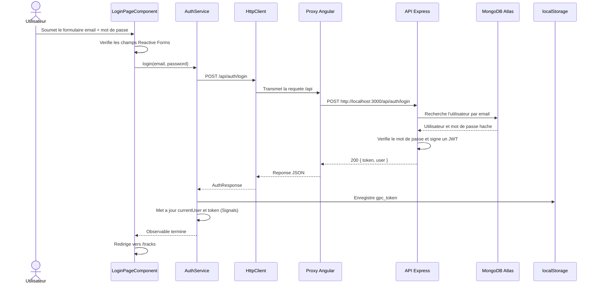
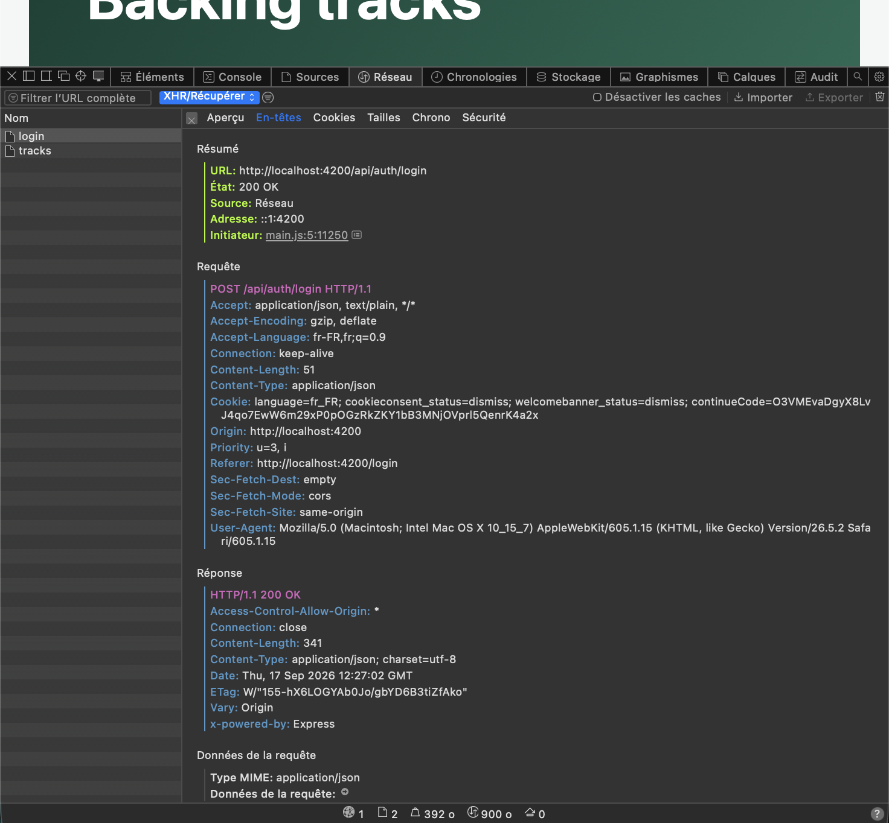
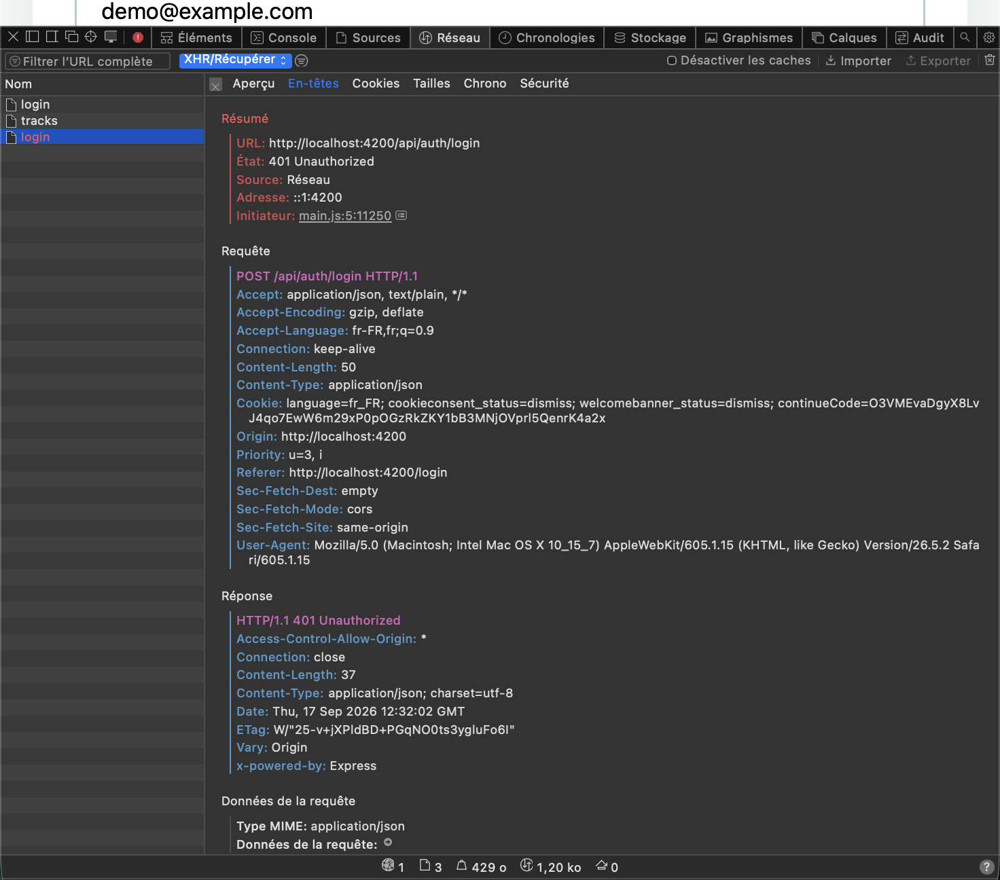
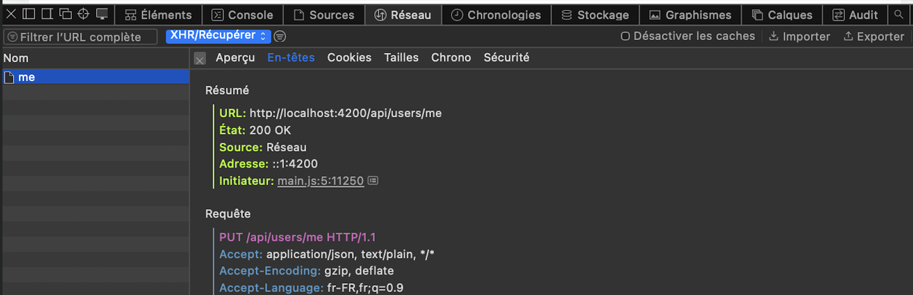

# Schema du flux de connexion - TP1

## Clic sur « Se connecter »



## Responsabilites

| Etape | Fichier | Responsabilite |
|---|---|---|
| Formulaire et clic | `frontend-starter/src/app/components/login-page/login-page.ts` | Valide le formulaire et appelle `AuthService` |
| Appel HTTP | `frontend-starter/src/app/shared/services/auth.service.ts` | Envoie `POST /api/auth/login` |
| Proxy local | `frontend-starter/proxy.conf.json` | Redirige `/api` vers `http://localhost:3000` |
| API | `backend/src/app.js` | Traite la connexion et renvoie le JWT et l'utilisateur public |
| Persistance | MongoDB Atlas | Conserve les utilisateurs et les metadonnees |
| Etat navigateur | `AuthService` | Conserve le JWT dans `localStorage` et l'utilisateur dans des Signals |
| Requetes protegees | `frontend-starter/src/app/shared/interceptors/auth.interceptor.ts` | Ajoute `Authorization: Bearer <token>` |

Angular ne communique jamais directement avec MongoDB. Le trajet est :

```text
composant Angular -> AuthService -> HttpClient -> proxy -> API Express -> MongoDB Atlas
```

## Routes publiques

Ces routes ne necessitent pas d'en-tete `Authorization` :

| Methode | Route | Usage |
|---|---|---|
| `GET` | `/api/health` | Verifier que l'API repond |
| `POST` | `/api/auth/register` | Creer un compte et obtenir un JWT |
| `POST` | `/api/auth/login` | Se connecter et obtenir un JWT |

## Routes protegees

Ces routes necessitent `Authorization: Bearer <token>` :

| Methode | Route | Usage |
|---|---|---|
| `GET` | `/api/users/me` | Lire le profil de l'utilisateur connecte |
| `PUT` | `/api/users/me` | Modifier le nom de l'utilisateur connecte |
| `GET` | `/api/tracks?page=1&limit=5` | Lire la bibliotheque paginee |
| `POST` | `/api/tracks` | Envoyer une piste audio multipart |
| `GET` | `/api/tracks/:id/audio` | Lire l'audio d'une piste autorisee |
| `DELETE` | `/api/tracks/:id` | Supprimer une piste appartenant a l'utilisateur |

Le guard Angular protege les routes `/profile` et `/tracks` contre l'absence de token. Il ne remplace pas la verification du JWT par le middleware `auth` du backend.

## Preuve Network 1 : connexion réussie



- Requête : `POST /api/auth/login`
- Statut : `200 OK`
- Type de contenu : `application/json`
- Vérification : aucun mot de passe ni JWT n'est visible dans la capture.

## Preuve Network 2 : connexion refusée



- Requête : `POST /api/auth/login`
- Statut : `401 Unauthorized`
- Vérification : l'API refuse les identifiants invalides et aucun mot de passe ni JWT n'est visible dans la capture.

## Preuve Network 3 : modification du profil



- Requête : `PUT /api/users/me`
- Statut : `200 OK`
- Type de contenu : `application/json`
- Vérification : la requête est protégée par l'intercepteur JWT.
- Sécurité : la valeur réelle de l'en-tête `Authorization` doit être masquée dans la capture.